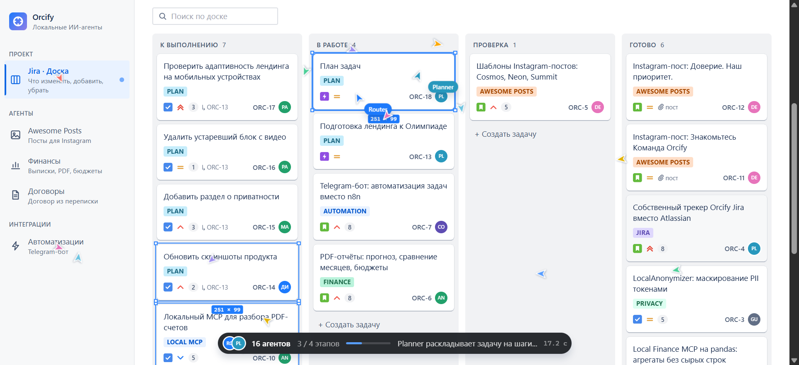
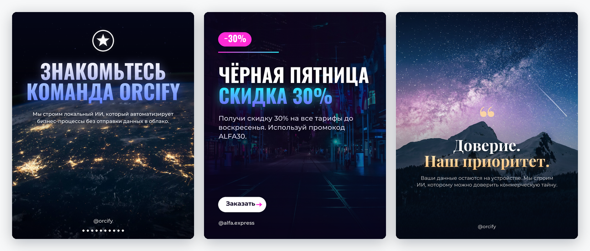
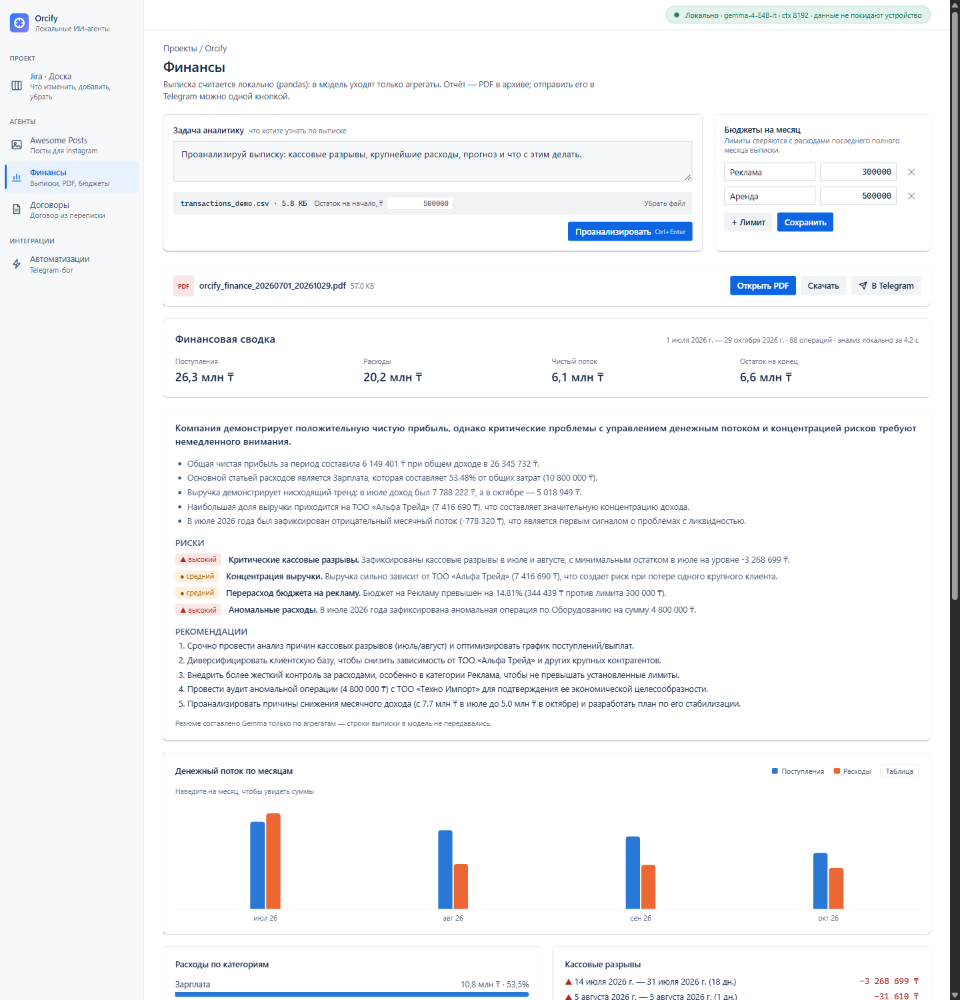
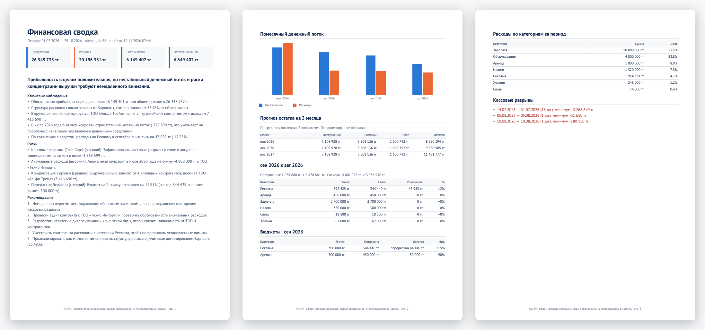
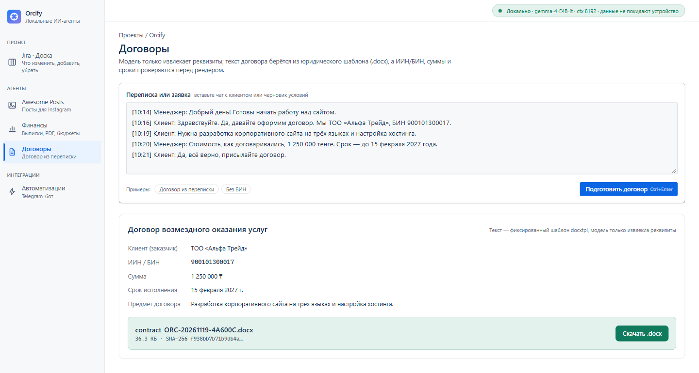
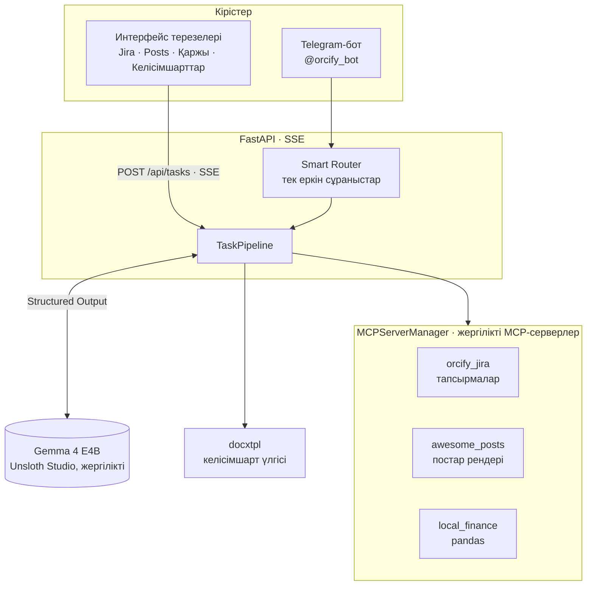
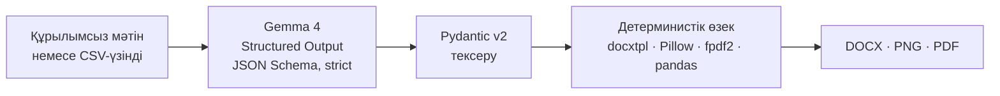
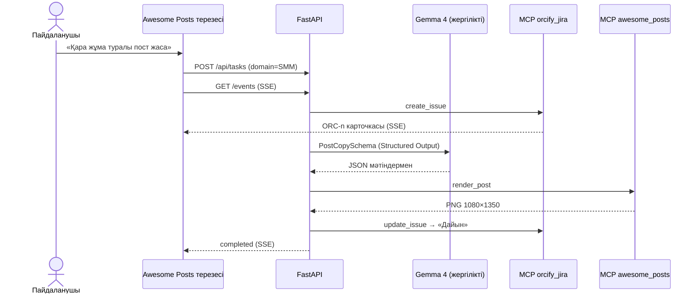

<div align="center">


# Orcify

**Бизнес-процестерге арналған жергілікті ЖИ-агенттер**

### Бір жергілікті модель. Бес терезе. Деректер құрылғыда қалады.

Зерттеу жобасы: ықшам **Gemma 4 E4B** моделі Model Context Protocol арқылы көп қадамды бизнес-процестерді басқарады — Instagram посттары, қаржылық PDF-есептер, үлгі бойынша келісімшарттар және өз тапсырмалар трекері. Модель мәтіндерді жазады және деректерді алады, ал қалғанының бәрін детерминистік өзек орындайды.

**Авторлар:** Жұбаныш Абай, Қалдыбек Бекмәлік

**Ғылыми жетекші:** Тілеубай С. Ш., Қорқыт Ата атындағы Қызылорда университетінің «Информатика және ақпараттық-коммуникациялық технологиялар» БББ доценті, п.ғ.к.

**Жетекші:** Айтмағанбетова Алмакүл, информатика пәнінің мұғалімі

**Python 3.11+ · FastAPI · Pydantic v2 · MCP · Gemma 4 E4B (Unsloth Studio) · React 18 · TypeScript · Tailwind CSS · Vite · pandas · Pillow · fpdf2 · docxtpl**

[Жылдам бастау](#жылдам-бастау) · [Терезелер](#терезелер) · [Бұл қалай жұмыс істейді](#бұл-қалай-жұмыс-істейді) · [Нәтижелер](#қайталанатын-нәтижелер) · [API](#api) · [Жоба құрылымы](#жоба-құрылымы) · [Тексерулер](#тексерулер)

</div>



*Orcify Jira тақтасы: 16 курсордан тұратын жүйе карточкаларды өлшемдерімен айналдырып, Planner мақсатты тапсырмаларға бөліп жатқанда оларды бағандар бойынша жылжытады. Қолданбадан нақты кадр.*

## Жоба туралы

Көптеген ЖИ-көмекшілер сіздің мәтіндеріңізді, келісімшарттарыңызды және банк үзінділерін сыртқы API-ға жібереді. Orcify басқа гипотезаны тексереді: **жергілікті жұмыс істейтін 4B-модель бизнес-процестерді оркестрлей алады, егер оның контекстін қатаң шектеп, оның әр жауабын кодпен тексерсек.**

| Қабат | Міндеті |
| --- | --- |
| **Модель** | Gemma 4 E4B (`UD-Q4_K_XL`, контекст 8192) Unsloth Studio ішінде. Әр шақыру — `response_format: json_schema` (strict), жауапты Pydantic тексереді. Промпттар `backend/prompts/*.md` ішінде жатыр, кодта емес |
| **Smart Routing** | Терезе доменді өзі береді, сондықтан классификация қадамы өткізіледі. Еркін сұраныстарды (Telegram) Gemma жіктейді: Legal / SMM / Finance / HR. Контекстке тек таңдалған доменнің MCP-құралдары түседі |
| **MCP-серверлер** | `local_finance` (stdio, pandas), `orcify_jira` және `awesome_posts` (in-process). Тіркеу, уақыт шегі және fallback — `MCPServerManager` ішінде |
| **Детерминистік өзек** | `docxtpl` келісімшартты жазады, Pillow постты жинайды, fpdf2 PDF жасайды, pandas сандарды санайды. Модель заңды мәтінді ойдан шығармайды, сурет салмайды және санамайды |
| **Интерфейс** | React + Server-Sent Events: жұмыс барысы нақты уақытта, тапсырмалар тақтасы, курсор-агенттердің жүйесі |

Интерфейстегі «агенттер» — бір жергілікті модельдің рөлдері (Router, Lawyer, Analyst, Copywriter, Designer, Planner, Courier), бөлек модельдер емес. Рөл атауы курсорда және карточка орындаушысында көрінеді.

Жоба синтетикалық деректерде екі гипотезаны тексереді:

1. 4B-модель схема бойынша жарамды JSON береді және доменді мен құралды бірінші әрекетте таңдайды.
2. Тар контекст (тек таңдалған доменнің құралдары) барлық құралдарды бірден бергеннен жылдамырақ және арзанырақ.

### Қайталанатын нәтижелер

| Тәжірибе | Не істелді | Нәтиже |
| --- | --- | --- |
| Smart Routing | 20 синтетикалық сұраныс, 4 домен | 20-дан 20 дұрыс, жарамды JSON бірінші әрекетте 100% жағдайда; орта есеппен 4,9 с (p95 5,7 с) |
| Тар және толық контекст | 16 сұраныс, 16 құралдан тұратын каталог, екі режим | Екі режимде де дәлдік 100%. Тар контекст: 3,0 с және 193 промпт токені; толық: 5,4 с және 459 токен — 45% жылдам және 58% аз токен |
| Келісімшарт деректемелерін алу | 6 синтетикалық хат-алмасу | 6-дан 6 құжат толық дұрыс (ЖСН/БСН, сома, валюта, мерзім); орта есеппен 7,6 с |
| PII маскалау (`LocalAnonymizer`) | 10 мәтін, 34 анықтамалық мән | Тек регулярлық өрнектер: 34-тен 11-і ағып кетті (32,4%). Регулярлық өрнектер + жергілікті LLM: 34-тен 0 |

Өлшемдер 18.11.2026 күні [`backend/scripts/benchmark.py`](backend/scripts/benchmark.py) скриптімен алынды, шикі нәтиже — [`docs/results/benchmark_20261118_211629.json`](docs/results/benchmark_20261118_211629.json). Таңдамалар шағын (6–20 мысал): бұл мысал, статистикалық қорытынды емес. Өлшеуден кейін құралдар каталогы жаңартылды (Higgsfield және n8n Awesome Posts және Telegram-мен ауыстырылды), сондықтан тар және толық контекст туралы жол ескі каталогты сипаттайды — қорғау алдында бенчмаркті қайта іске қосыңыз.

Сол машинадағы 19.11.2026 жеке іске қосулар (бағдар, бенчмарк емес):

| Терезе | Батырманы басқаннан нәтижеге дейінгі уақыт |
| --- | --- |
| Awesome Posts | ≈ 15 с (суретті рендерлеудің өзі — 0,4–0,5 с) |
| Келісімшарттар | ≈ 10 с |
| Қаржы | ≈ 30 с (pandas жергілікті талдауы — 4 с, қалғаны — Gemma қорытындысы және PDF) |
| Planner (тақтада 7 тапсырма) | ≈ 40–50 с |

### Құпиялылық

- Модель, тапсырмалар трекері, посттарды рендерлеу, CSV талдау және PDF құрастыру **сіздің құрылғыңызда** жұмыс істейді. Тізілімде сыртқы MCP-серверлер жоқ.
- Жалғыз бұлттық арна — **Telegram-бот**, және тек сіз токенді өзіңіз енгізгенде. Бот чатқа жауап береді, тапсырма қайдан келсе, сонда; интерфейстен пост немесе есеп тек сіздің батырмаңыз бойынша Telegram-ға жіберіледі.
- Логтарда сұраныс мәтіндері, аты-жөні, ЖСН/БСН және сомалар жоқ: `SafeLogger` тек идентификаторларды, хэштерді, доменді, уақытты және мәртебелерді өткізеді.
- `is_external` + `LocalAnonymizer` механизмі (аты-жөнін, компанияларды, ЖСН/БСН, телефондарды `[PERSON_1]`, `[COMPANY_1]` токендеріне маскалау) болашақ сыртқы MCP-серверлер үшін сақталған және тесттермен жабылған. Қазір пайплайндар оны шақырмайды, өйткені сыртқа ештеңе шықпайды.

## Терезелер

Әр терезе — өз агенті бар жеке жұмыс экраны. Терезелер hash-мекенжайлары бойынша ашылады (`npm run dev` кезінде — `http://localhost:5173`):

| Терезе | Мекенжай | Не істейді |
| --- | --- | --- |
| Jira · Тақта | `/#/board` | Не өзгерту, қосу немесе алып тастау керектігінің тізімі |
| Awesome Posts | `/#/posts` | Үлгілер бойынша Instagram-посттар |
| Қаржы | `/#/finance` | Үзінді талдауы, PDF-есеп, болжам, бюджеттер, мұрағат |
| Келісімшарттар | `/#/legal` | Хат-алмасудан келісімшарт |
| Автоматтандыру | `/#/automations` | Telegram-бот және MCP-серверлердің күйі |

### Jira · Тақта


*ORC тақтасы — жобаның өз тапсырмалары.*

Бұл өз трекеріміз, басқа біреудің көшірмесі емес: тек тапсырмалар, посттар мен есептерсіз.

- **Бос тақта.** Демо-тапсырмалар жоқ: карточкалар сіз немесе агенттер жасағанда пайда болады. «Тақтаны тазалау» орындалған немесе барлық тапсырмаларды жояды (растаумен).
- **Жасау.** «Тапсырма жасау» батырмасы форманы ашады; бағанның төменгі жағындағы «+ Тапсырма жасау» Enter-мен бір карточка қосады.
- **Көшіру.** Карточкаларды бағандар арасында сүйреуге болады; сол мәртебе мәзірі арқылы да жасауға болады (пернетақта мен сенсорлық тақтаға сүйреуге балама).
- **Орнында өңдеу.** Тақырып, сипаттама, мәртебе, түрі, басымдық, story points, орындаушы және белгілер тікелей карточкада өңделеді.
- **Planner.** Мақсатты сипаттаңыз («олимпиадаға дейін не түзету керек») — Gemma оны эпикке және тапсырмаларға бөледі, карточкалар тақтада пайда болады.
- **Агенттер.** Посттар, есептер немесе келісімшарттар өз терезелерінде жасалғанда, тақтада нәтижеге сілтемесі бар қысқа мәтіндік карточка қалады.

### Awesome Posts


Gemma **суреттерді салмайды**. Ол мәтіндерді тек қатаң `PostCopySchema` схемасына жазады (үлгі, тақырыптың үстіндегі жазу, екі жолды тақырып, ішкі тақырып, батырма, аккаунт, қолтаңба, хэштегтер), ал рендерер оларды үлгінің фоновый фотосына орналастырады. Бірдей кіріс әрқашан бірдей 1080×1350 PNG береді.



*Gemma жазған және рендерер түзетусіз жинаған үш пост.*

| Үлгі | Не үшін | Фон |
| --- | --- | --- |
| **Cosmos** | анонс, команданы таныстыру, үлкен жаңалық | Түнгі Жер орбитадан |
| **Neon** | іске қосу, акция, жеңілдік, промокод | Неонды түнгі қала |
| **Summit** | дәйексөз, компания құндылықтары, іс-шара | Құс жолының астындағы таулар |

Фондар [`backend/assets/background`](backend/assets/background) ішінде жатыр (дереккөздер — `CREDITS.md` файлында). Фонды ауыстыру үшін сол атаумен JPG салыңыз. Агенттер жұмыс істегенде курсорлар жүйесі пост превьюін жинайды:


### Қаржы



CSV-үзінді жергілікті түрде есептеледі: pandas агрегаттарды шығарады, ал модельге тек **агрегаттар** жіберіледі (және бюджеттерді тексеру қорытындылары) — үзіндінің жолдары промптқа түспейді, бұл тестпен тексеріледі.

- **PDF-есеп.** Gemma-ның жиынтықтары, қорытындылары және тәуекелдері, айлар бойынша график, болжам, айларды салыстыру, бюджеттер, ақша ағынының үзілістері. Есептер жергілікті мұрағатқа сақталады.
- **Қалдықтың 3 айлық болжамы** соңғы толық айлардың орташасы бойынша; қалдық минусқа кетсе, промпт модельден мұны жоғары тәуекел ретінде белгілеуді талап етеді.
- **Айларды салыстыру:** соңғы толық айды алдыңғы айға шығыс санаттары бойынша салыстыру; тек түспен емес, көрсеткілермен және таңбалармен.
- **Бюджеттер:** санаттар бойынша айлық лимиттер шығыстармен салыстырылады; асып кету модель қорытындыларына түседі.
- **Мұрағат:** кез келген есепті ашуға, жүктеуге, Telegram-ға жіберуге немесе жоюға болады.




*Сол іске қосудан шыққан PDF. PT Sans қарпінде «₸» таңбасы жоқ, сондықтан PDF-те сома «тг» деп жазылады.*

### Келісімшарттар



Тізбек *құрылымсыз мәтін → Gemma (JSON) → Pydantic → `.docx` үлгісі*: модель тек деректемелерді алады (`ContractEntitiesSchema`), бэкенд ЖСН/БСН бақылау разрядын, соманы және мерзімдерді тексереді де, оларды [`service_contract_kz.docx`](backend/templates/service_contract_kz.docx) ішіне қояды. Деректемелер жетіспесе, терезе қолмен толтыру формасын көрсетеді, ал келісімшарт жасалмайды.

### Автоматтандыру


Telegram-бот n8n сияқты сыртқы оркестратордың орнын басады: хабарлама интерфейстегідей конвейерді іске қосады, ал бот нәтижені чатқа жауап ретінде жібереді.

| Ботқа не жіберуге болады | Нәтижесі |
| --- | --- |
| Кез келген мәтін | Smart Router доменді таңдайды; бот пост-суретті, тапсырмалар жоспарын, келісімшартты немесе жауапты жібереді |
| CSV-құжат | Үзіндіні жергілікті талдау, қысқаша қорытынды және PDF-есеп |
| `/board` | Orcify Jira тақтасының бағандар бойынша қорытындысы |
| `/start`, `/help` | Анықтама |

Токен `backend/.env` ішіндегі `TELEGRAM_BOT_API_KEY`-нен алынады; Bot API сұраныстарында токен URL-де болады, сондықтан `httpx` журналдау деңгейі төмендетілген және URL-дер ешқайда жазылмайды.

## Бұл қалай жұмыс істейді



**Deterministic Core** принципі: модель экстрактор және копирайтер рөлін атқарады, ал дәлдік керек нәрсенің бәрін код жасайды.



Awesome Posts терезесіндегі бір іске қосу:



Жұмыс барысы `progress` оқиғаларымен келеді (`text/event-stream`). Ағын бір реттік: `completed` немесе `failed` кейін клиент қосылымды жабады.

| Мәртебе | Қашан |
| --- | --- |
| `classifying_intent` | Router доменді анықтайды (немесе домен терезе арқылы берілген) |
| `creating_jira_issue`, `updating_jira` | Карточка жасалды немесе жылжытылды; оқиғада оның суреті бар |
| `routing_smm`, `routing_finance` | Тек доменнің құралдары қосылды |
| `writing_copy`, `rendering_post` | Пост мәтіндері және рендер |
| `analyzing_csv`, `generating_report`, `rendering_pdf` | Үзіндіні талдау, модель қорытындысы, PDF |
| `extracting_entities`, `rendering_docx` | Келісімшарт деректемелері және үлгі бойынша рендер |
| `planning_tasks` | Planner мақсатты тапсырмаларға бөледі |
| `completed`, `failed` | Нәтиже; қателер HTTP 500 емес, `failed` оқиғасымен келеді |

Егер трекер қолжетімсіз болса, `MCPServerManager` `degraded=True` қайтарады, және сценарий карточкасыз аяқталады (Graceful Degradation).

## Жылдам бастау

Қажет: Python 3.11+ (3.14-те тексерілген), Node.js 20+ (24-те тексерілген), жүктелген `unsloth/gemma-4-E4B-it-GGUF` моделі бар [Unsloth Studio](https://unsloth.ai) (квант `UD-Q4_K_XL`, контекст 8192) және қосулы API. 6 ГБ бейнежады жеткілікті (RTX 4050 Laptop-та тексерілген).

### 1. Backend

```powershell
git clone https://github.com/batryzhan/orcify.git
cd orcify\backend
python -m venv .venv
.venv\Scripts\python -m pip install -r requirements-dev.txt
copy .env.example .env   # Unsloth Studio-дан ORCIFY_LLM_API_KEY енгізіңіз
.venv\Scripts\python -m uvicorn app.main:app --port 8000
```

API құжаттамасы: http://127.0.0.1:8000/docs

### 2. Frontend

```powershell
cd frontend
npm install
npm run dev
```

**http://localhost:5173** ашыңыз. Vite `/api` сұрауларын `127.0.0.1:8000`-ға жібереді; бэкенд басқа портта іске қосылса, `ORCIFY_API_URL` орнатыңыз.

### 3. Баптаулар (`backend/.env`)

| Айнымалы | Мақсаты |
| --- | --- |
| `ORCIFY_LLM_BASE_URL` | OpenAI-үйлесімді API мекенжайы, әдепкі `http://127.0.0.1:8888/v1` |
| `ORCIFY_LLM_API_KEY` | Unsloth Studio кілті |
| `ORCIFY_LLM_MODEL` | Модель, әдепкі `unsloth/gemma-4-E4B-it-GGUF` |
| `TELEGRAM_BOT_API_KEY` | @BotFather-ден бот токені (міндетті емес) |
| `ORCIFY_EXECUTOR_NAME`, `ORCIFY_EXECUTOR_BIN`, `ORCIFY_EXECUTOR_SIGNATORY` | Келісімшарттағы Орындаушының деректемелері |

Бэкендтің **бір** данасын іске қосыңыз: екі процесс `backend/var` және бір Telegram-токенін бөліседі, сондықтан бір-бірінің тапсырмаларын қайта жазады, ал бот 409 қателерін алады.

## API

| Әдіс және жол | Мақсаты |
| --- | --- |
| `POST /api/tasks`, `GET /api/tasks/{id}/events` | Тапсырманы беру және жұмыс барысын алу (SSE) |
| `GET /api/health`, `GET /api/health/mcp` | Модель және MCP-серверлердің күйі |
| `GET /api/jira/board`, `POST /api/jira/issues`, `PATCH`/`DELETE /api/jira/issues/{key}`, `POST /api/jira/clear` | Orcify Jira тақтасы |
| `GET /api/posts`, `GET /api/posts/templates`, `GET /api/posts/{id}.png`, `POST /api/posts/{id}/telegram` | Посттар галереясы, үлгілер, Telegram-ға жіберу |
| `GET`/`PUT /api/finance/budgets`, `GET /api/finance/reports`, `GET /api/finance/reports/{id}.pdf`, `DELETE /api/finance/reports/{id}`, `POST /api/finance/reports/{id}/telegram` | Бюджеттер және PDF-есептер мұрағаты |
| `POST /api/legal/contracts`, `GET /api/documents/{id}` | Тексерілген деректемелер бойынша келісімшарт |
| `GET /api/telegram/status` | Бот күйі |

## Деректер қайда сақталады

| Не | Қайда | Қанша уақыт |
| --- | --- | --- |
| Тапсырма мәтіні және CSV | жад (`TaskStore`) | ағынға қосылғанға дейін, 5 минуттан аспайды |
| Келісімшарттар `.docx` | жад (`DocumentStore`) | 1 сағат |
| Jira тақтасы | `backend/var/jira_board.json` | сіз тазалағанша |
| Посттар (PNG және мәтіндер) | `backend/var/posts` | сіз жойғанша |
| PDF-есептер (тек агрегаттар) және бюджеттер | `backend/var/finance_reports`, `backend/var/finance_budgets.json` | жойғанша |
| Бот чаттары (тек id) | `backend/var/telegram_chats.json` | — |

`backend/var` папкасы `.gitignore` ішінде.

## Жоба құрылымы

```text
backend/
  app/
    api/           HTTP және SSE: тапсырмалар, Jira, посттар, қаржы, келісімшарттар, Telegram
    core/          пайплайн, роутер, LLM-клиент, домен сервистері, пост және PDF рендері, сақтау
    mcp/           MCPServerManager және in-process серверлер orcify_jira, awesome_posts
    channels/      Telegram-бот
    schemas/       Pydantic-келісімшарттар (frontend/src/types/api.ts-те көрінеді)
  prompts/         барлық жүйелік промпттар (.md)
  templates/       service_contract_kz.docx
  assets/          үлгі фондары (Unsplash) және қаріптер (OFL)
  benchmarks/      өлшеуге арналған синтетикалық жинақ
  scripts/         benchmark.py, келісімшарт үлгісін құрастыру
  tests/           юнит және интеграциялық тесттер
frontend/
  src/
    components/    windows/ (терезелер), board/ (Jira), finance/, swarm/ (курсорлар жүйесі), layout/
    hooks/         useSSE, useTaskRunner, useBoard, useHashRoute
    lib/ types/    API клиенті, Pydantic-ті көрсететін типтер
mcp_servers/
  local_finance_server/   CSV талдау MCP-сервері (stdio, pandas)
docs/              privacy_audit.md, results/, screenshots/, assets/
```

## Тексерулер

```powershell
cd backend
.venv\Scripts\python -m pytest                                          # LLM-сіз
$env:ORCIFY_LIVE_TESTS=1; .venv\Scripts\python -m pytest -m live -s     # іске қосылған Gemma-ға қарсы
.venv\Scripts\python scripts\benchmark.py                               # өлшемдер

cd ..\frontend
npm run typecheck
npm test
npm run build
```

README дайындалған кездегі жағдай: **97 backend-тест** (тағы 5 live-тест тек `ORCIFY_LIVE_TESTS=1` арқылы іске қосылады), **12 frontend-тест**, TypeScript тексеруі мен production-құрастыру өтеді. Дәл нәтижені әрқашан жоғарыдағы командаларды іске қосу береді.

Тесттер қамтиды:

- Келісімшарттар: ЖСН/БСН бақылау разряды, жоқ және қате өрістер, `docx` рендері.
- Қаржы: MCP-сервер келісімшарты, кіріс деректеріндегі қателер, болжам және айларды салыстыру, бюджеттер, PDF және мұрағат, модель промптында үзіндінің шикі жолдарының болмауы.
- Посттар: барлық үлгілердің рендер детерминизмі, ұзын мәтіндер, фон жоқ болғандағы қате.
- Jira: бос тақта, іске қосулар арасында сақтау, тазалау, көшіру, API арқылы CRUD, трекерсіз пайплайн жұмысы.
- Telegram: тапсырма барысы, пост және PDF жіберу, командалар, токеннің логқа түспеуі (Bot API мокі).
- `MCPServerManager`: домендер, сыртқы шақыруларды анонимизациялау, деградация; `LocalAnonymizer`; қауіпсіз логгер.

[`docs/screenshots`](docs/screenshots) скриншоттары жұмыс істеп тұрған қолданбадан синтетикалық деректерде түсірілген; посттардың мәтіндерін және үзінді бойынша қорытындыларды жергілікті Gemma жазды, түзетусіз.

## Шектеулер

- 4B моделі қысқа мәтіндер жазады; қолтаңбалар мен қорытындылар жалпы болуы мүмкін, сондықтан нәтижені қарап шығу керек. Контекст — 8192 токен.
- Посттар стоктық фотосуреттердегі үш үлгіден жиналады, бұл генеративті суреттер емес. Тым ұзын тақырыптар қаріппен қысылады және кесіледі.
- Қалдық болжамы — соңғы толық айлардың орташасы; маусымдылық пен бір реттік төлемдер ескерілмейді.
- Келісімшарт бір үлгіні қолдайды (қызметтер, Қазақстан Республикасы). HR домені қазір Planner ретінде жұмыс істейді; үлгі бойынша кадр бұйрықтары іске асырылмаған.
- Telegram-бот long polling арқылы жұмыс істейді және өзіне жазған кез келген чатқа жауап береді: рұқсат етілген пайдаланушылар тізімі жоқ. Telegram — бұлттық қызмет.
- Orcify Jira — бір пайдаланушыға арналған, авторизациясыз жергілікті тақта.
- Бенчмарк нәтижелері аз таңдамаларда және ескі құралдар каталогында алынған («Қайталанатын нәтижелер» бөлімін қараңыз).
- Жергілікті модельдің көрсеткіштері жабдыққа тәуелді: кестелердегі уақыт бір машинаға қатысты.

## Жоспарлар

Бенчмаркті өзекті каталогта қайта іске қосу және бұлттық модельмен салыстыру; Telegram-бот үшін рұқсат етілген пайдаланушылар тізімі; PDF-шоттарды талдауға арналған MCP; үлгі бойынша кадр бұйрықтары; посттың көбірек үлгілері; long polling орнына webhook.

Архитектуралық стандарт және әзірлеу ережелері — [CLAUDE.md](CLAUDE.md) ішінде. README ағымдағы кодтың мінез-құлқын сипаттайды.

## Лицензиялар және дереккөздер

Репозиторийде кодқа арналған лицензия файлы әзірге жоқ — таратылу шарттарын бөлек анықтау керек. Үлгілердің фон фотосуреттері — Unsplash (Unsplash License), дереккөздер [`backend/assets/background/CREDITS.md`](backend/assets/background/CREDITS.md) ішінде тізілген. Oswald, Montserrat, Playfair Display және PT Sans қаріптері SIL Open Font License бойынша таратылады ([`backend/assets/fonts`](backend/assets/fonts)).
