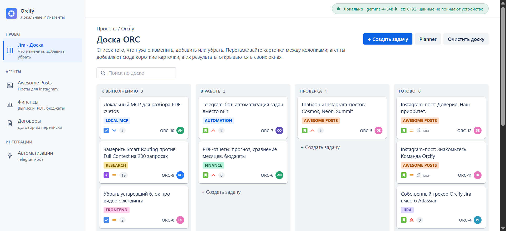
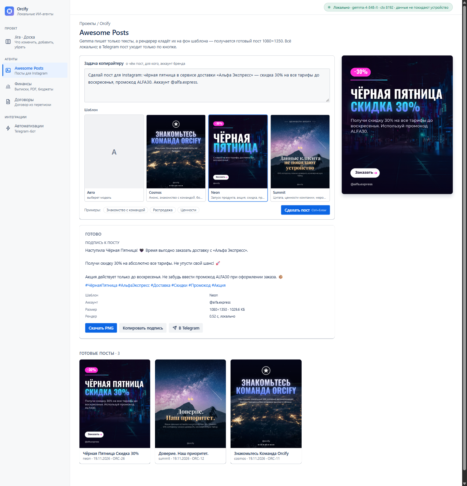
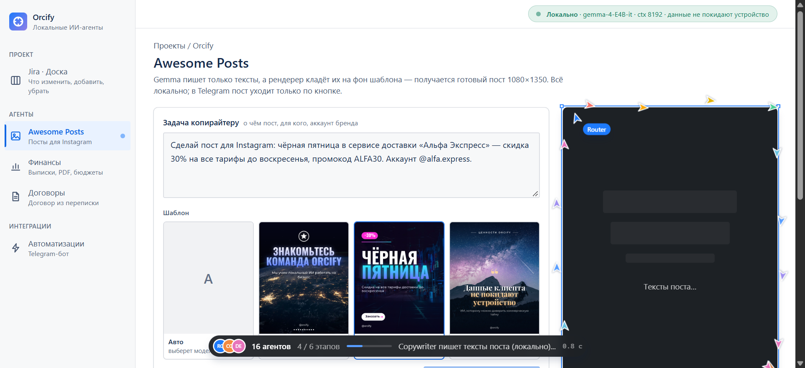
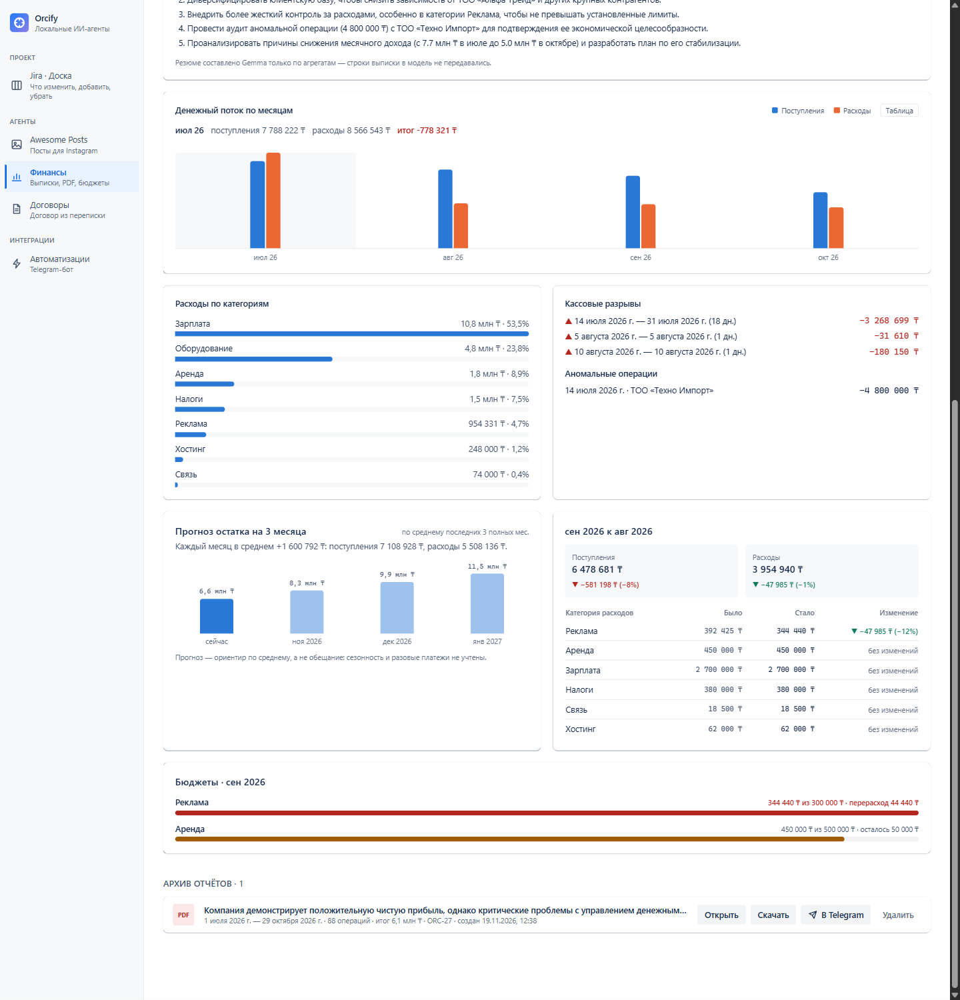
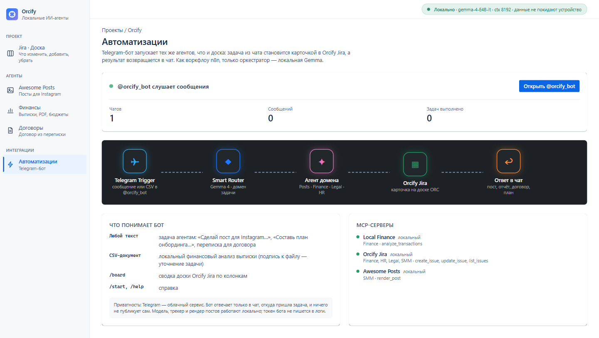
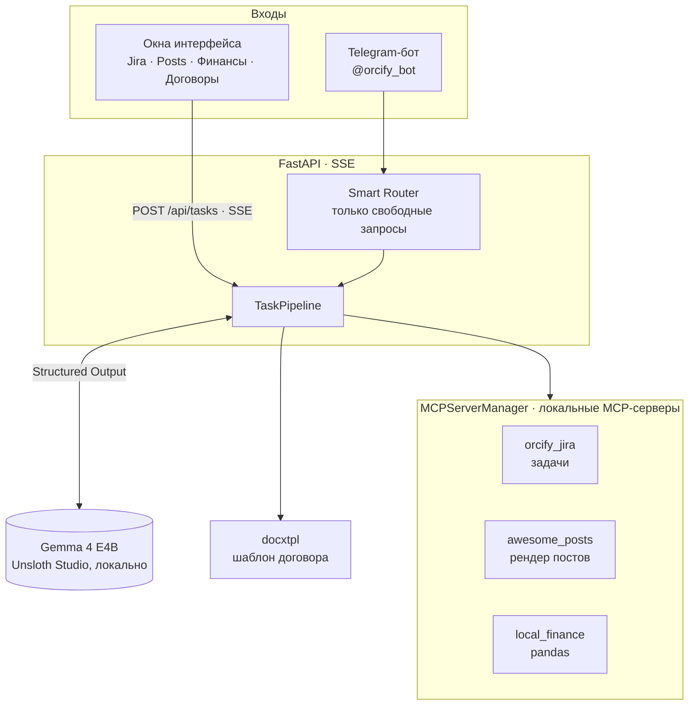
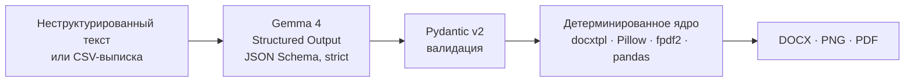
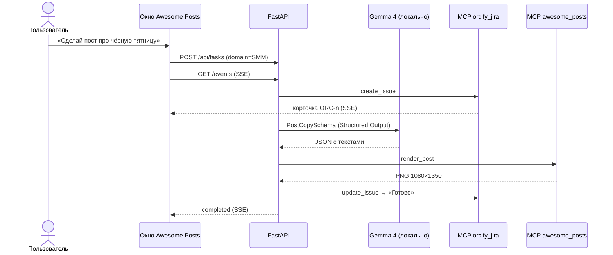

<div align="center">


# Orcify

**Локальные ИИ-агенты для бизнес-процессов**

### Одна локальная модель. Пять окон. Данные остаются на устройстве.

Исследовательский проект: компактная модель **Gemma 4 E4B** оркестрирует многошаговые бизнес-процессы через Model Context Protocol — Instagram-посты, финансовые PDF-отчёты, договоры по шаблону и собственный трекер задач. Модель извлекает и пишет тексты, а всё остальное делает детерминированное ядро.

<!-- Авторы, учебное заведение, научный руководитель: добавьте сюда строки в формате «**Авторы:** …» -->

**Python 3.11+ · FastAPI · Pydantic v2 · MCP · Gemma 4 E4B (Unsloth Studio) · React 18 · TypeScript · Tailwind CSS · Vite · pandas · Pillow · fpdf2 · docxtpl**

[Быстрый старт](#быстрый-старт) · [Окна](#окна) · [Как это работает](#как-это-работает) · [Результаты](#воспроизводимые-результаты) · [API](#api) · [Структура](#структура-проекта) · [Проверки](#проверки)

</div>


*Доска Orcify Jira: рой из 16 курсоров обводит карточки с размерами и двигает их по колонкам, пока Planner раскладывает цель на задачи. Реальный кадр из приложения.*

## О проекте

Большинство ИИ-ассистентов отправляют ваши тексты, договоры и банковские выписки во внешний API. Orcify проверяет другую гипотезу: **4B-модель, работающая локально, справляется с оркестрацией бизнес-процессов, если жёстко ограничить ей контекст и проверять каждый её ответ кодом.**

| Слой | Задача |
| --- | --- |
| **Модель** | Gemma 4 E4B (`UD-Q4_K_XL`, контекст 8192) в Unsloth Studio. Каждый вызов — `response_format: json_schema` (strict), ответ проверяет Pydantic. Промпты лежат в `backend/prompts/*.md`, не в коде |
| **Smart Routing** | Окно интерфейса само задаёт домен, поэтому этап классификации пропускается. Свободные запросы (Telegram) классифицирует Gemma: Legal / SMM / Finance / HR. В контекст попадают только MCP-инструменты выбранного домена |
| **MCP-серверы** | `local_finance` (stdio, pandas), `orcify_jira` и `awesome_posts` (in-process). Регистрация, таймауты и fallback — в `MCPServerManager` |
| **Детерминированное ядро** | `docxtpl` пишет договор, Pillow собирает пост, fpdf2 собирает PDF, pandas считает цифры. Модель не сочиняет юридический текст, не рисует и не считает |
| **Интерфейс** | React + Server-Sent Events: ход работы в реальном времени, доска задач, рой агентов-курсоров |

«Агенты» в интерфейсе — это роли одной и той же локальной модели (Router, Lawyer, Analyst, Copywriter, Designer, Planner, Courier), а не отдельные модели. Имя роли видно на курсоре и у исполнителя карточки.

Проект проверяет две гипотезы на синтетических данных:

1. Модель размером 4B выдаёт валидный JSON по схеме и выбирает домен и инструмент с первой попытки.
2. Узкий контекст (только инструменты выбранного домена) быстрее и дешевле, чем весь набор инструментов сразу.

### Воспроизводимые результаты

| Эксперимент | Что сделано | Результат |
| --- | --- | --- |
| Smart Routing | 20 синтетических запросов, 4 домена | 20 из 20 верно, валидный JSON с первой попытки в 100% случаев; в среднем 4,9 с (p95 5,7 с) |
| Узкий и полный контекст | 16 запросов, каталог из 16 инструментов, два режима | Точность 100% в обоих режимах. Узкий контекст: 3,0 с и 193 токена промпта; полный: 5,4 с и 459 токенов — на 45% быстрее и на 58% меньше токенов |
| Извлечение реквизитов договора | 6 синтетических переписок | 6 из 6 документов полностью верны (ИИН/БИН, сумма, валюта, срок); в среднем 7,6 с |
| Маскирование PII (`LocalAnonymizer`) | 10 текстов, 34 эталонных значения | Только регулярные выражения: утекли 11 из 34 (32,4%). Регулярные выражения + локальная LLM: 0 из 34 |

Замеры сняты 18.11.2026 скриптом [`backend/scripts/benchmark.py`](backend/scripts/benchmark.py), сырой результат — [`docs/results/benchmark_20261118_211629.json`](docs/results/benchmark_20261118_211629.json). Выборки маленькие (6–20 примеров): это иллюстрация, а не статистический вывод. После замеров каталог инструментов в наборе обновили (Higgsfield и n8n заменены на Awesome Posts и Telegram), поэтому строка про узкий и полный контекст описывает прежний каталог — перед защитой перезапустите бенчмарк.

Единичные прогоны на той же машине 19.11.2026 (ориентиры, не бенчмарк):

| Окно | Время от нажатия до результата |
| --- | --- |
| Awesome Posts | ≈ 15 с (сам рендер картинки — 0,4–0,5 с) |
| Договоры | ≈ 10 с |
| Финансы | ≈ 30 с (локальный анализ pandas — 4 с, остальное — резюме Gemma и PDF) |
| Planner (7 задач на доске) | ≈ 40–50 с |

### Приватность

- Модель, трекер задач, рендер постов, анализ CSV и сборка PDF работают **на вашем устройстве**. Внешних MCP-серверов в реестре нет.
- Единственный облачный канал — **Telegram-бот**, и только если вы сами вписали токен. Бот отвечает в чат, откуда пришла задача; пост или отчёт из интерфейса уходит в Telegram только по вашей кнопке.
- Логи не содержат текстов запросов, ФИО, ИИН/БИН и сумм: `SafeLogger` пропускает только идентификаторы, хэши, домен, тайминги и статусы.
- Механизм `is_external` + `LocalAnonymizer` (маскирование ФИО, компаний, ИИН/БИН, телефонов в токены `[PERSON_1]`, `[COMPANY_1]`) сохранён для будущих внешних MCP-серверов и покрыт тестами. Сейчас пайплайны его не вызывают, потому что наружу ничего не уходит.

## Окна

Каждое окно — отдельный рабочий экран со своим агентом. Окна открываются по адресам на hash (при `npm run dev` — `http://localhost:5173`):

| Окно | Адрес | Что делает |
| --- | --- | --- |
| Jira · Доска | `/#/board` | Список того, что изменить, добавить или убрать |
| Awesome Posts | `/#/posts` | Instagram-посты по шаблонам |
| Финансы | `/#/finance` | Анализ выписки, PDF-отчёт, прогноз, бюджеты, архив |
| Договоры | `/#/legal` | Договор из переписки |
| Автоматизации | `/#/automations` | Telegram-бот и состояние MCP-серверов |

### Jira · Доска



*Доска ORC с задачами самого проекта.*

Это собственный трекер, а не клон чужого: только задачи, без постов и отчётов.

- **Пустая доска.** Демо-задач нет: карточки появляются, когда их создаёте вы или агенты. «Очистить доску» удаляет выполненные или все задачи (с подтверждением).
- **Создание.** Кнопка «Создать задачу» открывает форму; «+ Создать задачу» внизу колонки добавляет карточку одним Enter.
- **Перенос.** Карточки перетаскиваются между колонками; то же можно сделать меню статуса в карточке (альтернатива перетаскиванию для клавиатуры и тачпада).
- **Редактирование на месте.** Заголовок, описание, статус, тип, приоритет, story points, исполнитель и метки правятся прямо в карточке.
- **Planner.** Опишите цель («что доработать перед олимпиадой») — Gemma разложит её на эпик и задачи, и карточки появятся на доске.
- **Агенты.** Когда посты, отчёты или договоры делаются в своих окнах, на доске остаётся короткая текстовая карточка со ссылкой на результат.

### Awesome Posts



Gemma **не рисует картинки**. Она пишет только тексты в строгую схему `PostCopySchema` (шаблон, надпись над заголовком, двухстрочный заголовок, подзаголовок, кнопка, аккаунт, подпись, хэштеги), а рендерер кладёт их на фоновое фото шаблона. Одинаковый вход всегда даёт одинаковый PNG 1080×1350.


*Три поста, написанные Gemma и собранные рендерером без правок.*

| Шаблон | Для чего | Фон |
| --- | --- | --- |
| **Cosmos** | анонс, знакомство с командой, большая новость | Земля ночью с орбиты |
| **Neon** | запуск, акция, скидка, промокод | ночной город с неоном |
| **Summit** | цитата, ценности компании, мероприятие | горы под Млечным Путём |

Фоны лежат в [`backend/assets/background`](backend/assets/background) (источники — в `CREDITS.md`). Чтобы поменять фон, положите JPG с тем же именем. Пока агенты работают, рой курсоров собирает превью поста:



### Финансы


CSV-выписка считается локально: pandas выдаёт агрегаты, а в модель уходят **только агрегаты** (и итоги проверки бюджетов) — строки выписки в промпт не попадают, это проверяется тестом.

- **PDF-отчёт.** Итоги, выводы и риски Gemma, график по месяцам, прогноз, сравнение месяцев, бюджеты, кассовые разрывы. Отчёты складываются в локальный архив.
- **Прогноз остатка на 3 месяца** по среднему последних полных месяцев; если остаток уходит в минус, промпт требует от модели отметить это как высокий риск.
- **Сравнение месяцев:** последний полный месяц против предыдущего по категориям расходов, со стрелками и знаками, а не только цветом.
- **Бюджеты:** месячные лимиты по категориям сверяются с расходами; перерасход попадает в выводы модели.
- **Архив:** открыть, скачать, отправить в Telegram или удалить любой отчёт.




*PDF из того же прогона. В шрифте PT Sans нет знака «₸», поэтому в PDF сумма пишется «тг».*

### Договоры


Цепочка *неструктурированный текст → Gemma (JSON) → Pydantic → шаблон `.docx`*: модель только извлекает реквизиты (`ContractEntitiesSchema`), бэкенд проверяет контрольный разряд ИИН/БИН, сумму и даты и подставляет их в [`service_contract_kz.docx`](backend/templates/service_contract_kz.docx). Если реквизитов не хватает, окно покажет форму для ручного ввода, а договор не сформируется.

### Автоматизации



Telegram-бот заменяет внешний оркестратор вроде n8n: сообщение запускает тот же конвейер, что и интерфейс, и бот отвечает в чат результатом.

| Что отправить боту | Что произойдёт |
| --- | --- |
| Любой текст | Smart Router выбирает домен; бот присылает пост-картинку, план задач, договор или ответ |
| CSV-документ | Локальный анализ выписки, краткая сводка и PDF-отчёт |
| `/board` | Сводка доски Orcify Jira по колонкам |
| `/start`, `/help` | Справка |

Токен берётся из `TELEGRAM_BOT_API_KEY` в `backend/.env`; запросы к Bot API содержат токен в URL, поэтому уровень логирования `httpx` понижен и URL нигде не пишутся.

## Как это работает



Принцип **Deterministic Core**: модель выступает экстрактором и копирайтером, а всё, что должно быть точным, делает код.



Один запуск в окне Awesome Posts:



Ход работы приходит событиями `progress` (`text/event-stream`). Стрим одноразовый: после `completed` или `failed` клиент закрывает соединение.

| Статус | Когда |
| --- | --- |
| `classifying_intent` | Router определяет домен (или домен задан окном) |
| `creating_jira_issue`, `updating_jira` | Карточка создана или перенесена; в событии лежит её снимок |
| `routing_smm`, `routing_finance` | Подключены только инструменты домена |
| `writing_copy`, `rendering_post` | Тексты поста и рендер |
| `analyzing_csv`, `generating_report`, `rendering_pdf` | Анализ выписки, резюме модели, PDF |
| `extracting_entities`, `rendering_docx` | Реквизиты договора и рендер по шаблону |
| `planning_tasks` | Planner раскладывает цель на задачи |
| `completed`, `failed` | Итог; ошибки приходят событием `failed`, а не HTTP 500 |

Если трекер недоступен, `MCPServerManager` возвращает `degraded=True`, и сценарий завершается без карточки (Graceful Degradation).

## Быстрый старт

Нужны Python 3.11+ (проверено на 3.14), Node.js 20+ (проверено на 24) и [Unsloth Studio](https://unsloth.ai) с загруженной моделью `unsloth/gemma-4-E4B-it-GGUF` (квант `UD-Q4_K_XL`, контекст 8192) и включённым API. Видеокарты с 6 ГБ видеопамяти достаточно (проверено на RTX 4050 Laptop).

### 1. Backend

```powershell
git clone https://github.com/batryzhan/orcify.git
cd orcify\backend
python -m venv .venv
.venv\Scripts\python -m pip install -r requirements-dev.txt
copy .env.example .env   # впишите ORCIFY_LLM_API_KEY из Unsloth Studio
.venv\Scripts\python -m uvicorn app.main:app --port 8000
```

Документация API: http://127.0.0.1:8000/docs

### 2. Frontend

```powershell
cd frontend
npm install
npm run dev
```

Откройте **http://localhost:5173**. Vite проксирует `/api` на `127.0.0.1:8000`; если бэкенд запущен на другом порту, задайте `ORCIFY_API_URL`.

### 3. Настройки (`backend/.env`)

| Переменная | Назначение |
| --- | --- |
| `ORCIFY_LLM_BASE_URL` | Адрес OpenAI-совместимого API, по умолчанию `http://127.0.0.1:8888/v1` |
| `ORCIFY_LLM_API_KEY` | Ключ Unsloth Studio |
| `ORCIFY_LLM_MODEL` | Модель, по умолчанию `unsloth/gemma-4-E4B-it-GGUF` |
| `TELEGRAM_BOT_API_KEY` | Токен бота от @BotFather (необязательно) |
| `ORCIFY_EXECUTOR_NAME`, `ORCIFY_EXECUTOR_BIN`, `ORCIFY_EXECUTOR_SIGNATORY` | Реквизиты Исполнителя в договоре |

Запускайте **один** экземпляр бэкенда: два процесса делят `backend/var` и один Telegram-токен, поэтому перезаписывают задачи друг друга, а бот получает ошибки 409.

## API

| Метод и путь | Назначение |
| --- | --- |
| `POST /api/tasks`, `GET /api/tasks/{id}/events` | Поставить задачу и получить ход работы (SSE) |
| `GET /api/health`, `GET /api/health/mcp` | Состояние модели и MCP-серверов |
| `GET /api/jira/board`, `POST /api/jira/issues`, `PATCH`/`DELETE /api/jira/issues/{key}`, `POST /api/jira/clear` | Доска Orcify Jira |
| `GET /api/posts`, `GET /api/posts/templates`, `GET /api/posts/{id}.png`, `POST /api/posts/{id}/telegram` | Галерея постов, шаблоны, отправка в Telegram |
| `GET`/`PUT /api/finance/budgets`, `GET /api/finance/reports`, `GET /api/finance/reports/{id}.pdf`, `DELETE /api/finance/reports/{id}`, `POST /api/finance/reports/{id}/telegram` | Бюджеты и архив PDF-отчётов |
| `POST /api/legal/contracts`, `GET /api/documents/{id}` | Договор по проверенным реквизитам |
| `GET /api/telegram/status` | Состояние бота |

## Где хранятся данные

| Что | Где | Сколько |
| --- | --- | --- |
| Текст задачи и CSV | память (`TaskStore`) | до подключения к стриму, не дольше 5 минут |
| Договоры `.docx` | память (`DocumentStore`) | 1 час |
| Доска Jira | `backend/var/jira_board.json` | пока не очистите |
| Посты (PNG и тексты) | `backend/var/posts` | пока не удалите |
| PDF-отчёты (только агрегаты) и бюджеты | `backend/var/finance_reports`, `backend/var/finance_budgets.json` | до удаления |
| Чаты бота (только id) | `backend/var/telegram_chats.json` | — |

Папка `backend/var` в `.gitignore`.

## Структура проекта

```text
backend/
  app/
    api/           HTTP и SSE: задачи, Jira, посты, финансы, договоры, Telegram
    core/          пайплайн, роутер, LLM-клиент, сервисы доменов, рендер постов и PDF, хранилища
    mcp/           MCPServerManager и in-process серверы orcify_jira, awesome_posts
    channels/      Telegram-бот
    schemas/       Pydantic-контракты (зеркалируются в frontend/src/types/api.ts)
  prompts/         все системные промпты (.md)
  templates/       service_contract_kz.docx
  assets/          фоны шаблонов постов (Unsplash) и шрифты (OFL)
  benchmarks/      синтетический набор для замеров
  scripts/         benchmark.py, сборка шаблона договора
  tests/           юнит- и интеграционные тесты
frontend/
  src/
    components/    windows/ (окна), board/ (Jira), finance/, swarm/ (рой курсоров), layout/
    hooks/         useSSE, useTaskRunner, useBoard, useHashRoute
    lib/ types/    клиент API, типы, зеркалирующие Pydantic
mcp_servers/
  local_finance_server/   MCP-сервер анализа CSV (stdio, pandas)
docs/              privacy_audit.md, results/, screenshots/, assets/
```

## Проверки

```powershell
cd backend
.venv\Scripts\python -m pytest                                          # без LLM
$env:ORCIFY_LIVE_TESTS=1; .venv\Scripts\python -m pytest -m live -s     # против запущенной Gemma
.venv\Scripts\python scripts\benchmark.py                               # замеры

cd ..\frontend
npm run typecheck
npm test
npm run build
```

На момент подготовки README: **97 backend-тестов** (ещё 5 live-тестов запускаются только с `ORCIFY_LIVE_TESTS=1`), **12 frontend-тестов**, проверка TypeScript и production-сборка проходят. Точный результат всегда даёт запуск команд выше.

Тесты покрывают:

- Договоры: контрольный разряд ИИН/БИН, пропущенные и неверные поля, рендер `docx`.
- Финансы: контракт MCP-сервера, ошибки входных данных, прогноз и сравнение месяцев, бюджеты, PDF и архив, отсутствие сырых строк выписки в промпте модели.
- Посты: детерминизм рендера всех шаблонов, длинные тексты, ошибка при отсутствии фона.
- Jira: пустая доска, сохранение между запусками, очистка, перенос, CRUD через API, работа пайплайна без трекера.
- Telegram: ход задачи, отправка поста и PDF, команды, токен не попадает в логи (мок Bot API).
- `MCPServerManager`: домены, анонимизация внешних вызовов, деградация; `LocalAnonymizer`; безопасный логгер.

Скриншоты в [`docs/screenshots`](docs/screenshots) сняты с работающего приложения на синтетических данных; тексты постов и выводы по выписке написала локальная Gemma, без правок.

## Ограничения

- Модель размером 4B пишет короткие тексты; подписи и выводы бывают общими, поэтому результат нужно просматривать. Контекст — 8192 токена.
- Посты собираются из трёх шаблонов на стоковых фото, это не генеративные изображения. Слишком длинные заголовки сжимаются шрифтом и обрезаются.
- Прогноз остатка — среднее последних полных месяцев; сезонность и разовые платежи не учитываются.
- Договор поддерживает один шаблон (услуги, Республика Казахстан). Домен HR сейчас работает как Planner; кадровые приказы по шаблону не реализованы.
- Telegram-бот работает через long polling и отвечает в любой чат, который ему написал: списка разрешённых пользователей нет. Telegram — облачный сервис.
- Orcify Jira — локальная доска для одного пользователя без авторизации.
- Результаты бенчмарка получены на малых выборках и на прежнем каталоге инструментов (см. раздел «Воспроизводимые результаты»).
- Метрики локальной модели зависят от железа: время в таблицах относится к одной машине.

## Планы

Перезапуск бенчмарка на актуальном каталоге и сравнение с облачной моделью; список разрешённых пользователей для Telegram-бота; MCP для разбора PDF-счетов; кадровые приказы по шаблону; больше шаблонов постов; webhook вместо long polling.

Архитектурный стандарт и правила разработки — в [CLAUDE.md](CLAUDE.md). README описывает поведение текущего кода.

## Лицензии и источники

Файла лицензии для кода в репозитории пока нет — условия распространения нужно определить отдельно. Фоновые фото шаблонов — с Unsplash (Unsplash License), источники перечислены в [`backend/assets/background/CREDITS.md`](backend/assets/background/CREDITS.md). Шрифты Oswald, Montserrat, Playfair Display и PT Sans распространяются по SIL Open Font License ([`backend/assets/fonts`](backend/assets/fonts)).
