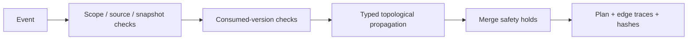

# Kernel v1: deterministic conservative preview

Status: pure planner, approval state machine, publication predicate and deterministic
version-pointer replay implemented. Durable application and executor remain Phase 2–3
work. This is not a validated performance result.

`plan_change(graph, event, policy)` consumes immutable explicit inputs, reads no
clock or random source and performs no network/database calls. Graph scope is
structural isolation, not authenticated authorization. The application must load
the scope from verified identity and authorize the human actor before planning.

1. Reject cross-scope event, stale snapshot hash, mismatched event/as-of time,
   missing/unconfirmed evidence, old version/hash mismatch or unconfirmed target.
2. Verify existing consumed HARD inputs against active upstream version/content
   hashes; missing/stale inputs require recomputation. Stale SOFT inputs require
   review. Unconfirmed mandatory requirements/evidence block derived outputs.
3. Walk the whole active dependency DAG in stable topological order. A changed
   target or previously stale node is an impact source.
4. HARD change propagates RECOMPUTE; HARD downstream of REVIEW retains a review
   hold; blocked dependencies propagate BLOCK. SOFT unknown fields require REVIEW;
   explicit relevant target fields recompute and disjoint fields retain. Fields of
   changed derived nodes are unknown, so their SOFT dependents require review.
   INFORMATIONAL edges retain with a machine-readable trace.
5. Combine incoming decisions with BLOCK > REVIEW > RECOMPUTE > KEEP. A node that
   needs recomputation but also depends on unresolved review must wait. Reasons
   preserve the mandatory recomputation cause even when execution is deferred.
6. Emit ordered affected-node rebuild candidates, per-node consumed-input signature,
   evidence references and edge reasons, non-publishable affected asset IDs,
   optional simulated serial cost/latency sum, snapshot hash and plan hash.

KEEP corresponds to PDF REUSE and means computational retention only. The preview
does not mutate current versions/approval history; a later service must apply it
atomically. `non_publishable_ids` identifies change-induced holds, not the complete
set of assets lacking approval. The pure predicate returns eligibility and reasons;
no publication endpoint or external side effect exists. Rebuild candidates may be
tasks or derived asset nodes; the executor must resolve each asset to its producing
task before executing. Previews do not generate asset versions.

`apply_approval` appends decisions bound to an asset-version ID and number, the
current requirement fingerprint, actor, policy, idempotency key and expected chain
revision. Rejection/revocation reasons are required. Revocation is a new decision;
old records remain immutable. A plan with stale graph snapshot or unresolved asset
ancestors cannot approve or publish. Publication also requires all current
requirements and asset evidence to have human confirmation and the latest
well-formed chain entry to be an exact APPROVED decision. An imported history is
validated for unique IDs/keys, sequential revisions, superseding links, advancing
times and legal decision transitions.

`EventReplayState.from_graph` captures scoped current version pointers and confirmed
evidence IDs. `apply_change_event` replaces one pointer and returns an immutable
receipt. Identical event replay returns the same receipt/state; reused IDs with
different payloads, stale projection hashes, gaps, old versions, unconfirmed
sources and non-advancing times fail. The reducer records hashes, not new content;
the database/application layer must persist the actual immutable snapshot and
append event atomically before issuing the next graph plan.

## Complexity and limitations

The implementation validates and visits the full graph, not only an affected
subgraph. Heap ordering costs O(V log V + E), with sorting edges/reasons and hashing
serialized snapshot bytes adding O(E log E + payload size) work. It keeps O(V+E)
state plus the serialized content. Node lookup used outside the core is linear;
the planner builds a map. These are code-level bounds, not measured timings.

No global optimization or unchanged-output pruning is implemented. All changed
HARD paths invalidate conservatively even when content is equal across versions.
Wrong but human-confirmed edge labels can still produce wrong impact; independently
reviewed gold data remains necessary. Full historical queries, time-scheduled changes,
authentication, approval/revoke database race safety, durable event deduplication,
provider failures and any external publication integration remain open gates. The supplied graph represents
current versions at exactly the event timestamp; future/backdated events reject.
