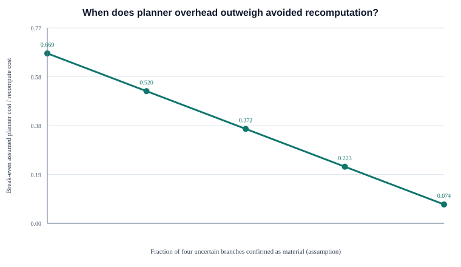

# R1.2 — Scientific audit of the R1.1 pilot

Status: audit of the saved R1.1 outputs, not a new benchmark. The original files in
[`../r1_1-pilot/`](../r1_1-pilot/) are unchanged. This audit does not authorize a larger
benchmark; the independent human review gate remains open.

## Reproduce the audit

From the repository root:

```powershell
.venv/Scripts/python scripts/audit_r1_1.py
.venv/Scripts/python -m pytest -q tests/test_r1_1_pilot.py tests/test_r1_2_audit.py
```

The script reads the saved R1.1 CSV files, checks row counts, method labels, and PASS
status, then writes an input-hash manifest, per-scenario accounting, a cost sensitivity
table, a break-even table, and one SVG. It refuses to write into the R1.1 directory by
default. It does not rerun planners or change R1.1 results. The audit's output files
are `scenario-accounting.csv`, `cost-sensitivity.csv`, `break-even.csv`,
`break-even.svg`, and `manifest.json`.

## What the original oracle does and does not establish

The R1.1 oracle is independent of GAMO-CA's implementation in a limited, useful sense:
the scenarios list expected HARD recomputations and uncertain SOFT review duties by
hand before a planner is called, and the check code does not call GAMO-CA to derive
those labels. It is not an independent gold standard. The same project team authored
the graph, event, expected labels, and checker, and no second annotator reviewed them.
The labels may therefore share the same assumptions or mistakes as the algorithm.

The checker tests these finite obligations, not every possible graph change. It
requires listed HARD targets to be `RECOMPUTE`; it accepts `REVIEW`, `RECOMPUTE`, or
`BLOCK` for uncertain SOFT targets. That is a safe-action check, not exact impact
classification. It does not prove that all affected nodes were listed in the oracle,
that every REVIEW will later be resolved correctly, or that the production approval
workflow was executed. Its eligibility calculation is a scorer-side check over
scenario-authored invalidations and each proposed action. It does not create a new
approval. The 15 PASS rows mean only that these plans passed this limited checker.

## Input comparability and safety

All three methods receive the same scenario graph and change event. Full Recompute
marks all derived assets except the edited source. Conventional DAG Incremental
independently walks the same graph's HARD and SOFT descendants, treating both as
invalidating dependencies and ignoring INFORMATIONAL edges. GAMO-CA calls the existing
pure planner with that graph, event, and a policy. No method receives a different
scenario, event, or content source.

The decision rules are not equally expressive: Full and DAG return KEEP/RECOMPUTE;
GAMO-CA can also return REVIEW. DAG deliberately chooses eager recomputation for
unknown SOFT descendants. The shared scorer still counts stale approvals and requires
exact approval after a regenerated version. Thus the three plans pass the same
scenario-level safety checker, but the comparison does not show that baseline
implementations provide the same review workflow or explanations. The DAG method is a
simple, conservative cache baseline, not every possible DAG cache policy.

Meanings used here:

- **KEEP** retains the current computed version. It grants no approval and says
  nothing by itself about publication.
- **REVIEW** pauses an item while a person resolves uncertain relevance or renews an
  invalidated approval. It schedules no generation immediately.
- **RECOMPUTE** schedules a new derived asset version using the current inputs. The
  new version has no inherited approval.
- **BLOCK** prevents progress while a required input or safety condition is unmet.

## Why the saved counts are 12 and 21

The saved immediate plan counts are Full Recompute 24, DAG 21, and GAMO-CA 12. The
12 GAMO-CA operations are exactly the hand-listed HARD recomputation obligations:
3 + 2 + 2 + 1 + 4 across the five cases. The DAG's 21 includes nine additional
descendant operations:

| Case | DAG | GAMO-CA now | Difference and reason |
| --- | ---: | ---: | --- |
| Slogan change | 6 | 3 | Three HARD text-path outputs recompute in both. GAMO-CA keeps `social_visual` because the changed field is text while the SOFT edge names palette. It holds `social_export` and HARD child `logo` for review. |
| Brand guideline change | 4 | 2 | Two color-relevant SOFT dependents recompute in both. GAMO-CA holds unknown `layout_review` and HARD child `final_export`. |
| Asset version update | 4 | 2 | Two HARD crops recompute in both. GAMO-CA holds uncertain `caption` and HARD child `caption_export`; unrelated `approved_copy` stays eligible. |
| Approval invalidation | 3 | 1 | The HARD compliance copy recomputes in both. GAMO-CA holds `legal_montage` and HARD child `legal_export`. The unrelated moodboard remains computationally KEEP, but its approval is stale under the modeled global requirement fingerprint. |
| All-HARD fanout | 4 | 4 | Every method recomputes all outputs. There is no recomputation advantage. |

Eight of the nine fewer immediate GAMO-CA operations are not established savings:
they are four uncertain SOFT review roots (`social_export`, `layout_review`,
`caption`, `legal_montage`) and their four HARD descendants (`logo`, `final_export`,
`caption_export`, `legal_export`). Each root/child pair stays on hold until review.
If the person confirms that each uncertain branch is materially affected, the four
roots and four descendants need recomputation; the conservative count becomes 20
versus 21 for DAG. If no branch is affected, those eight may be retained. R1.1 has no
human review outcomes, so neither endpoint is an observed result. The remaining
one-operation difference is the field-disjoint `social_visual` SOFT edge.

No node listed under R1.1's `must_recompute` obligations was replaced by `REVIEW`:
all 12 are `RECOMPUTE`. Four additional HARD descendants are currently `REVIEW`
because their upstream SOFT item is unresolved. This is a fail-closed pause in the
planner, not a completed hard-dependency recomputation. Correctness depends on a
later human decision followed by a fresh plan. R1.1 did not test that follow-up, so
the four must stay visible as conditional work in any cost comparison.

The review-operation totals were Full 25, DAG 24, and GAMO-CA 24. They count distinct
review/approval work proxies, including regenerated outputs needing exact-version
approval and approvals invalidated by the requirement fingerprint. They are not review
minutes. DAG obtains the same review count by regenerating more assets; GAMO-CA obtains
it through explicit holds and invalidation. The underlying human effort was not
measured.

## Transparent cost model and sensitivity

R1.1 measured operation counts and planner time. It did not measure generation time,
human time, tokens, or money. This audit therefore uses an abstract, hypothetical
work-unit model and keeps its three terms separate:

```text
C(method) = c_recompute * R(method)
          + c_review * H(method)
          + c_plan * T_ms(method)
```

`R` is the observed immediate recomputation count. For GAMO-CA sensitivity, its
expected accounting count is `12 + 8q`, where `q` is an assumed fraction of four
uncertain branches later found materially affected. Each such branch contains one
SOFT root and one HARD child. `H` is the observed review-operation proxy. `T_ms` is
the saved planner time, in milliseconds. `c_recompute = 1` work unit per regeneration,
`c_review` is varied over 0.25, 1, and 4 units per review, and `c_plan` is varied over
0, 0.01, 0.1, and 1 work unit per millisecond. All three coefficients are assumptions;
the work unit is not money or measured labor.

Across the five saved scenario medians, GAMO-CA's planner time sums to 13.4922 ms and
DAG's to 0.0352 ms, a difference of 13.4570 ms. The break-even condition for GAMO-CA
versus DAG is:

```text
GAMO is lower cost when c_plan / c_recompute < (9 - 8q) / 13.457
```

The assumed break-even ratios are 0.669 at `q=0`, 0.372 at `q=0.5`, and 0.074 at
`q=1` work units per millisecond per recomputation work unit. Below the threshold,
the assumed value of avoided regeneration dominates the measured planner-time gap;
above it, the current DAG implementation is preferable in this model. Since both
DAG and GAMO-CA have 24 review operations in aggregate, changing `c_review` does not
change their aggregate break-even point in this specific dataset. It does change
absolute hypothetical costs and comparisons with Full Recompute. Per-case review
counts do differ.

For example, at `q=0.5`, `c_recompute=1`, and `c_plan=0.01`, the expected GAMO count is
16 instead of 21, and its assumed planning penalty is about 0.135 units. GAMO-CA is
lower by about 4.865 hypothetical units before the equal review term. With the same
assumptions but `c_plan=0.5`, its planning penalty is about 6.729 units, so DAG is
lower by about 1.729 units. These are sensitivity examples, not observations about
real costs. The parameter `q` is not estimated from R1.1.



## Planning time: unfavorable observation and caveat

The R1.1 reported medians across the five per-scenario medians were 0.0027 ms for Full
Recompute, 0.0078 ms for DAG, and 3.1627 ms for GAMO-CA. In this implementation and
environment, GAMO-CA's median was about 406 times the DAG median. The audit reports
this unfavorable observation plainly. These tiny timings are plan-only and have no
content generation, human work, database, startup, or I/O. They are also not an even
runtime comparison: the baseline functions do simple iteration/reachability and
return short labels, while the GAMO-CA planner validates the graph and constructs
hashes, decisions, and explanations. The 101 repeated calls help stabilize a timer
reading but do not make 101 independent workload samples. The result is evidence
about the current functions on these tiny graphs, not a claim that GAMO-CA is
inherently 406 times slower.

## Student explanation and worked example

Think of each creative asset as a recipe that uses other items. A **HARD** link means
the recipe must be made again if an input changes. A **SOFT** link means the effect
depends on what changed. An **INFORMATIONAL** link is recorded context but does not
invalidate the recipe. GAMO-CA follows these links and compares changed fields with
the fields that matter to each SOFT link. It recomputes clear impacts, keeps proven
irrelevant impacts, and pauses uncertain ones for a person. A person must resolve a
pause before descendants can safely proceed.

For a slogan edit, the changed `req_slogan` feeds `copy` by a HARD edge. `copy` feeds
`captions` and `storyboard` by HARD edges, so all three are recomputed. `social_visual`
has a SOFT edge that only names `palette`; the changed field is `text`, so this
synthetic fixture says keep it. `social_export` has an unknown SOFT relationship, so
GAMO-CA asks for review. `logo` has a HARD edge from `social_export`; while the export
is undecided, the logo also waits. This gives three immediate recomputations, one
review root, and one held HARD descendant. If review later confirms impact, replan
and recompute the export and logo before using them. Pending review blocks eligibility.

Simple pseudocode:

```text
Full Recompute: recompute every derived asset other than the edited source.
DAG Incremental: walk all HARD and SOFT descendants; recompute each one.
GAMO-CA:
  walk from the changed node
  HARD edge with changed input -> RECOMPUTE
  SOFT edge with proven irrelevant changed fields -> KEEP
  SOFT edge with proven relevant changed fields -> RECOMPUTE
  SOFT edge with unknown relevance -> REVIEW
  HARD child of a REVIEW item -> REVIEW and wait for a new plan
  never treat KEEP as approval
```

## Limitations and decision

This audit improves accounting; it does not fix the original labels. Five deliberately
authored synthetic cases, one seed, no independent annotator, a global requirement
fingerprint assumption, no observed human review outcomes, an eager DAG policy, and
asymmetric planner work all limit interpretation. The 12 versus 21 count is not
evidence of 9 eliminated tasks. It is 8 tasks deferred behind review plus one
field-specific reuse in these authored graphs. At the all-HARD case there is no
advantage. Hypothetical cost weights cannot substitute for measured generation or
review effort.

**Recommendation: no-go for a larger benchmark until a second human reviews the
scenario edges, change-field labels, HARD/SOFT obligations, approval fingerprint scope,
and baseline policy.** After that review, correct and freeze the gold labels, then
test review resolution/replanning and align runtime work before scaling. This R1.2
audit itself is complete; the required human review has not happened and is not marked
complete in `TASK.md`.
